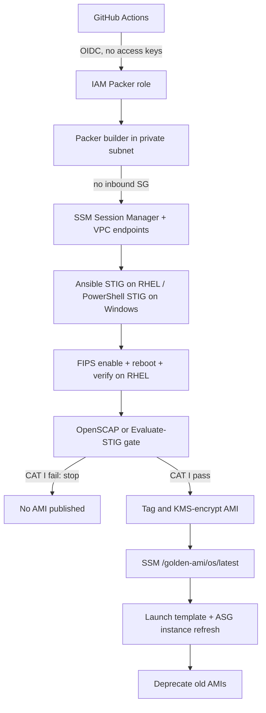

# govcloud-golden-ami-pipeline

Golden AMI factory for **RHEL 9** and **Windows Server 2022**, aimed at AWS GovCloud. Packer bakes the images, Ansible or PowerShell applies a curated set of real STIG settings, a scan gate blocks CAT I findings, and Terraform rolls a fleet forward with a launch-template instance refresh.

> **Honest status.** This is a portfolio demo. It has been formatted and validated offline (`terraform fmt/validate`, `packer fmt/validate`, `ansible-lint`, `tflint`, Checkov, gitleaks). It has **not** been applied or baked in a real AWS account.

Owner: **gkamta**. Companion to [devsecops-eks-demo](https://github.com/gkamta/devsecops-eks-demo).

Start with [`docs/WALKTHROUGH.md`](docs/WALKTHROUGH.md) for a step-by-step tour of the pipeline. To deploy the demo into a personal commercial AWS account, follow [`docs/DEPLOY-COMMERCIAL.md`](docs/DEPLOY-COMMERCIAL.md).

## How a bake flows



## What's in the repo

| Path | Purpose |
|---|---|
| `terraform/modules/iam-oidc` | GitHub OIDC provider and least-privilege Packer/CI role |
| `terraform/modules/kms` | CMK for AMIs, EBS, artifacts, and logs |
| `terraform/modules/packer-build-infra` | Bake VPC, SSM endpoints, no-inbound SG, instance profile, artifacts bucket |
| `terraform/modules/ami-lifecycle` | `/golden-ami/<os>/latest` and deprecation policy |
| `terraform/modules/launch-template-asg` | Launch template + rolling instance refresh |
| `terraform/envs/dev`, `terraform/envs/prod` | Separate S3 + DynamoDB state |
| `packer/rhel9`, `packer/windows2022` | Bake definitions (`us-gov-west-1` default, commercial fallback) |
| `ansible/roles` | `common`, `ssm_agent`, `rhel_stig`, `windows_stig`, `fips` |
| `scripts/` | OpenSCAP gate, Evaluate-STIG placeholder, SSM publish, deprecation |
| `.github/workflows` | lint, monthly/manual AMI bakes, Terraform plan + approved apply |

Defaults target **GovCloud** (`aws-us-gov`, `us-gov-west-1`). See [`docs/govcloud-partition.md`](docs/govcloud-partition.md). STIG IDs and the scan profiles are documented in [`docs/stig-and-scanning.md`](docs/stig-and-scanning.md). Selected RMF mappings are in [`docs/controls-mapping.md`](docs/controls-mapping.md).

## How to run (offline validation)

You do not need AWS credentials for this.

```bash
# Terraform
terraform fmt -recursive -check terraform
for d in terraform/envs/dev terraform/envs/prod terraform/bootstrap; do
  terraform -chdir="$d" init -backend=false -input=false
  terraform -chdir="$d" validate
done

# Packer (placeholder AMI so validate does not call AWS)
packer fmt -check -recursive packer
packer init packer/rhel9 && packer validate -var source_ami=ami-0123456789abcdef0 packer/rhel9
packer init packer/windows2022 && packer validate -var source_ami=ami-0123456789abcdef0 packer/windows2022

# Ansible and secrets
yamllint -c .yamllint.yml ansible
ansible-lint ansible
gitleaks git --config .gitleaks.toml --redact -v .
```

Or: `make ci` (also runs tflint, Checkov, and the OpenSCAP gate unit test).

## How to run (in an AWS account, when you are ready)

For a personal **commercial** AWS account in `us-east-1`, follow the numbered commands in [`docs/DEPLOY-COMMERCIAL.md`](docs/DEPLOY-COMMERCIAL.md). It covers the $10 budget alert, bootstrap, commercial `tfvars`, GitHub variables, a RHEL bake, Session Manager access, costs, and teardown.

The short version for any account (defaults are GovCloud):

1. Push this history to `gkamta/govcloud-golden-ami-pipeline`.
2. Apply `terraform/bootstrap` once to create the state bucket and lock table.
3. Copy `terraform/envs/dev/backend.hcl.example` and `terraform.tfvars.example` (or `terraform.tfvars.commercial.example` for commercial `us-east-1`), edit them, then `terraform init -backend-config=backend.hcl && terraform apply`.
4. Set GitHub Actions variables: `AWS_CI_ROLE_ARN` (from the apply output), `AWS_REGION`, `TF_STATE_BUCKET`, `TF_LOCK_TABLE`, `PACKER_VPC_ID`, `PACKER_SUBNET_ID`, `PACKER_SG_ID`, `PACKER_INSTANCE_PROFILE`, `AMI_KMS_KEY_ID`, `ARTIFACTS_BUCKET`. Create GitHub Environments `dev` and `prod`. Required reviewers for apply are recommended for prod.
5. Dispatch `.github/workflows/ami-rhel.yml` (and later `ami-windows.yml`). The jobs no-op with a notice until those variables exist.

Confirm Red Hat AMI owner IDs in the target partition before a real RHEL bake. In a disconnected enclave, leave `enable_nat_gateway = false` and point the builder at a mirrored repo.

## License

MIT © 2026 George Kamta
